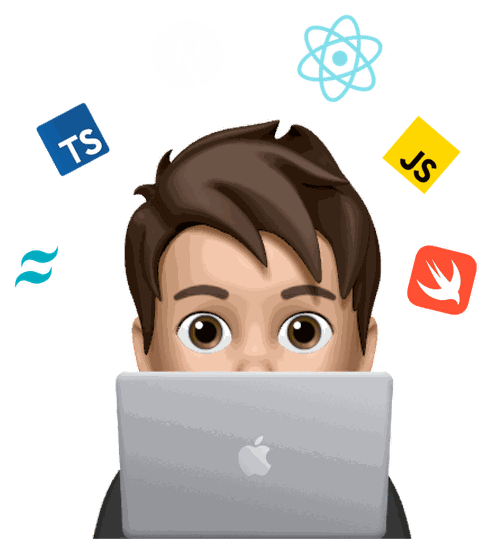

<h1>Hey, I'm Yashvardhan 👋</h1>

  Software engineer based in Delhi. Building with craft, shipping with purpose: apps, web, backends, and lately agents.

  
  
  
  
  
  

 

---

### 🧭 What I'm up to

- 🏦 Building **Self-Directed Investing** at **JPMorgan Chase** (previously at [Zuddl](https://www.zuddl.com/))
- 🌌 Building **Kin**, a private night sky for the people you love
- 🤖 Learning to build real agents (LangGraph and friends). **Potluck** is my first: a Telegram bot that figures out dinner and orders it over MCP
- 🏎️ Ran a side business making 3D-printed F1 tracks, and learnt ecommerce the hard way
- ✍️ Writing about what I build on [Medium](https://medium.com/@yashvardhanarora) and [LinkedIn](https://www.linkedin.com/in/yashvardhan-arora/)

### 🚀 Things I've built

| Project | What it is | Stack |
| --- | --- | --- |
| [**Kin**](https://github.com/yash22arora/Kin) ✨ | Every person you love is a star. Log a moment and their star glows. No accounts, no server, no guilt. Widgets, Siri and StoreKit 2 included. [kin.servatom.com](https://kin.servatom.com/) | `Swift` `SwiftUI` `SpriteKit` `WidgetKit` `App Intents` |
| [**Map Emulator**](https://github.com/yash22arora/MapEmulator) 🗺️ | A from-scratch simulation of how Uber, Rapido and Swiggy stream a rider's location so the dot glides instead of jumping. Hand-rolled SSE, backpressure-aware queues, built in 16 documented phases. | `Node` `Express` `TypeScript` `SwiftUI` `MapKit` |
| [**ChronoFrame**](https://github.com/yash22arora/reduce-fps) 🎞️ | Re-time any video to a custom FPS entirely in your browser. FFmpeg runs as WebAssembly, so your footage never gets uploaded. Auth, credits and payments included. [Live](https://reduce-fps.vercel.app) | `Next.js` `TypeScript` `WebAssembly` `Supabase` `Razorpay` |
| [**Potluck**](https://github.com/yash22arora/potluck) 🍲 | A Telegram group member that reads the dinner debate, decides cook / order / go out, and acts via Swiggy MCP. Nothing spends money without a human tap. *(early days)* | `Python` `Postgres` `Docker` `MCP` |
| [**Lift**](https://github.com/yash22arora/Lift) 🏋️ | A workout tracker with live sessions, rest timers, 1RM and volume charts, and HealthKit steps. Neon-on-obsidian design. | `SwiftUI` `SwiftData` `HealthKit` |
| [**Silo**](https://github.com/yash22arora/Silo-Mac) ⏱️ | A macOS menu-bar timer with a squeeze-and-bulge drag to set the time, in Liquid Glass. | `Swift` `AppKit` `SwiftUI` |
| [**Notefy**](https://github.com/Servatom/notefy) 📝 | Note-taking web app, built with a team at Servatom. 27★ 20 forks. | `React` `Django` |

Older web work (ServDomain, Gradeyard, Goreeva Quiz and more) lives in my <a href="https://github.com/yash22arora?tab=repositories">repositories</a>.

### 🧰 Toolbox

  

### 🎲 Random

- 🌠 Astrophile. It's not an accident that Kin is a night sky.
- 🎵 I can whistle to songs surprisingly well.
- 💬 Happy to chat about mobile, product ideas, or agents. Just reach out.

<!-- Last refreshed: Nov 2026 -->
